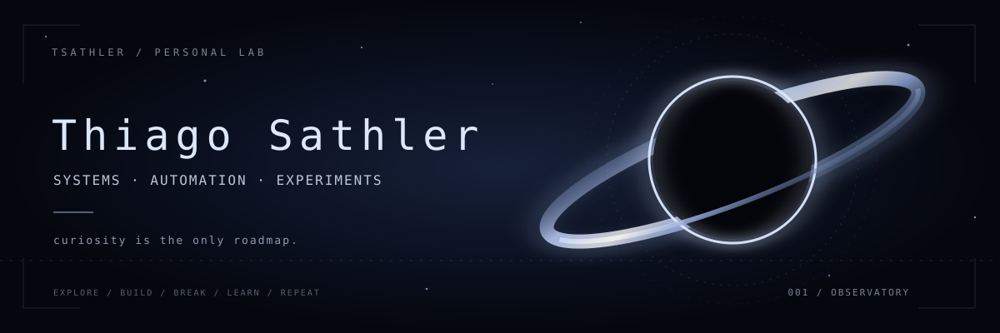

<div align="center">
  

  <br />

  <samp>✦ INDEPENDENT SIGNAL / TSATHLER ✦</samp>

  <h3>Curiosity is the only roadmap.</h3>

  <p>Systems &nbsp;·&nbsp; Automation &nbsp;·&nbsp; Creative coding &nbsp;·&nbsp; Experiments</p>

  <a href="https://github.com/tsathler?tab=repositories">Explore repositories</a>
  &nbsp;·&nbsp;
  <a href="https://github.com/tsathler/process-garden">Enter the garden</a>
</div>

<br />

### `01 / INCOMING TRANSMISSION`

> *Somewhere between a working prototype and a strange idea.*

I'm **Thiago**. I build things because I'm curious about how they work — and what they might become.

Sometimes it's a useful tool. Sometimes a small digital ecosystem. Sometimes a system that only exists because I wanted to see if I could make it.

I like **playful interfaces**, **backend logic**, **automation**, and projects with a personality of their own.

<br />

### `02 / EXPERIMENTS IN ORBIT`

<table>
  <tr>
    <td width="50%" valign="top">
      <h4><a href="https://github.com/tsathler/process-garden">✦ Process Garden</a></h4>
      <p>A little digital ecosystem where processes become living things.</p>
      <sub>EXPERIMENT / CREATIVE SYSTEMS</sub>
    </td>
    <td width="50%" valign="top">
      <h4><a href="https://github.com/tsathler/bookstack-docker-compose">✦ BookStack Docker Compose</a></h4>
      <p>A reproducible home for documentation, assembled with containers and configuration.</p>
      <sub>SELF-HOSTING / INFRASTRUCTURE</sub>
    </td>
  </tr>
  <tr>
    <td width="50%" valign="top">
      <h4><a href="https://github.com/tsathler/glpi-grafana-dashboards">✦ GLPI × Grafana</a></h4>
      <p>Turning operational information into clearer, more useful dashboards.</p>
      <sub>TOOLING / VISUALIZATION</sub>
    </td>
    <td width="50%" valign="top">
      <h4><a href="https://github.com/tsathler/windows-provisioning-toolkit">✦ Windows Provisioning Toolkit</a></h4>
      <p>Small automations for setting up and maintaining Windows environments.</p>
      <sub>AUTOMATION / TOOLING</sub>
    </td>
  </tr>
</table>

<br />

### `03 / FREQUENCIES I'M TUNING INTO`

```text
[ CREATIVE SYSTEMS ] Playful interfaces • interactive experiments
[ BACKEND SYSTEMS ]  Java • APIs • databases
[ TOOLMAKING ]      Python • PowerShell • Bash
[ INFRASTRUCTURE ]  Linux • Docker • Git
[ NEW IDEAS ]       Whatever seems interesting next
```

<br />

### `04 / LAB NOTES`

- Small experiments can become interesting worlds.
- Making something useful and making something fun aren't opposites.
- Breaking things is sometimes part of understanding them.
- Finished is good. Curious is better.

<br />

<div align="center">
  
  <p><samp>END OF TRANSMISSION // BACK TO BUILDING</samp></p>
  <sub>Made with curiosity, not a content strategy.</sub>
</div>
