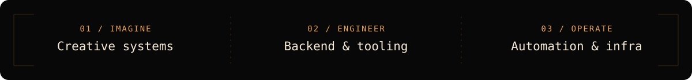

  
   
  <code>PERSONAL LAB / TRANSMISSION ACTIVE</code>
  <h3>Little experiments. Bigger questions.</h3>
  
I make software, build tools, and follow ideas that refuse to stay on paper.

  <a href="https://github.com/tsathler?tab=repositories">Browse the lab</a> &nbsp;·&nbsp; <a href="https://github.com/tsathler/process-garden">Visit Process Garden</a>

 

### `01 / THE PERSON BEHIND THE SIGNAL`

I'm **Thiago**, a hobbyist developer who likes taking an interesting idea and seeing how far it can go.

My projects move between **creative experiments**, **backend systems**, and **practical automation**. They don't all belong to one category — that's part of the fun. I enjoy the process of making something work, understanding *why* it works, and occasionally giving it a life of its own.

  

### `02 / OBJECTS IN ORBIT`

A few things I've been building and exploring.

<table>
<tr>
<td width="50%" valign="top">
  <strong><a href="https://github.com/tsathler/process-garden">PROCESS GARDEN</a></strong> CREATIVE COMPUTING / EXPERIMENT
  
An experimental little ecosystem where computer processes take on a life of their own.

  <a href="https://github.com/tsathler/process-garden">Explore experiment →</a>
</td>
<td width="50%" valign="top">
  <strong><a href="https://github.com/tsathler/glpi-grafana-dashboards">GLPI × GRAFANA</a></strong> DATA / VISUAL SYSTEMS
  
Dashboards that make technical operations easier to understand at a glance.

  <a href="https://github.com/tsathler/glpi-grafana-dashboards">Inspect project →</a>
</td>
</tr>
<tr>
<td width="50%" valign="top">
  <strong><a href="https://github.com/tsathler/windows-provisioning-toolkit">WINDOWS PROVISIONING TOOLKIT</a></strong> AUTOMATION / UTILITIES
  
Repeatable setup workflows for Windows machines — fewer manual steps, more consistency.

  <a href="https://github.com/tsathler/windows-provisioning-toolkit">Inspect toolkit →</a>
</td>
<td width="50%" valign="top">
  <strong><a href="https://github.com/tsathler/bookstack-docker-compose">BOOKSTACK DOCKER COMPOSE</a></strong> SELF-HOSTING / INFRASTRUCTURE
  
A container-based way to run a place for keeping knowledge organized.

  <a href="https://github.com/tsathler/bookstack-docker-compose">Inspect setup →</a>
</td>
</tr>
</table>

 

### `03 / CURRENT COORDINATES`

  

I'm exploring **Java and backend development**, experimenting with **Python**, and continuing to work with **Linux, Docker, PowerShell, SQL, and Git**. The tools change depending on the question I'm trying to answer.

 

### `04 / FIELD NOTES`

> I don't need every project to become a product. Sometimes understanding something — or making it a little more interesting — is enough.

I like projects that are small enough to start, strange enough to remember, and useful enough to revisit.

  
  <code>END OF TRANSMISSION / STILL EXPERIMENTING</code>

